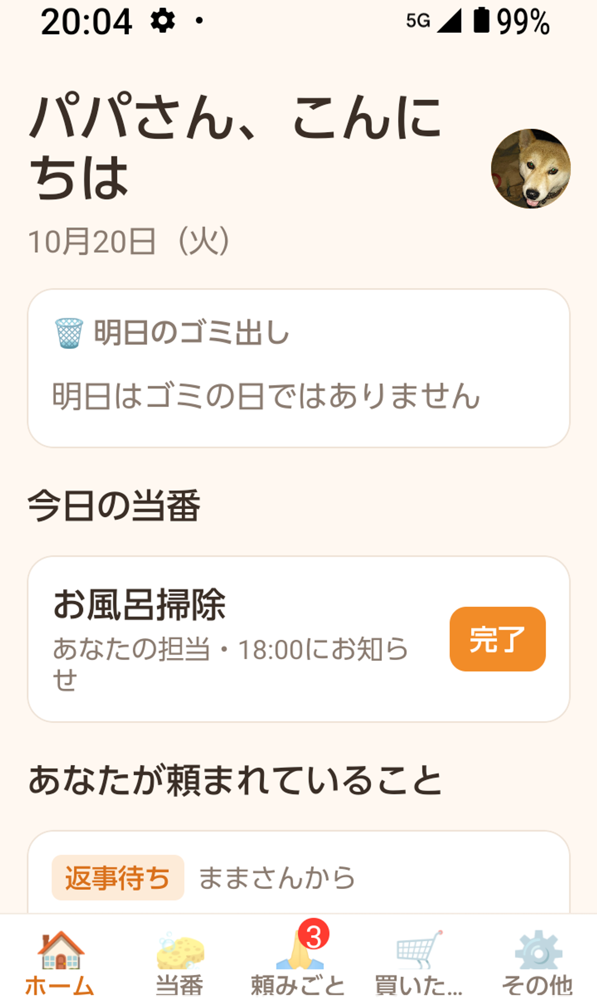
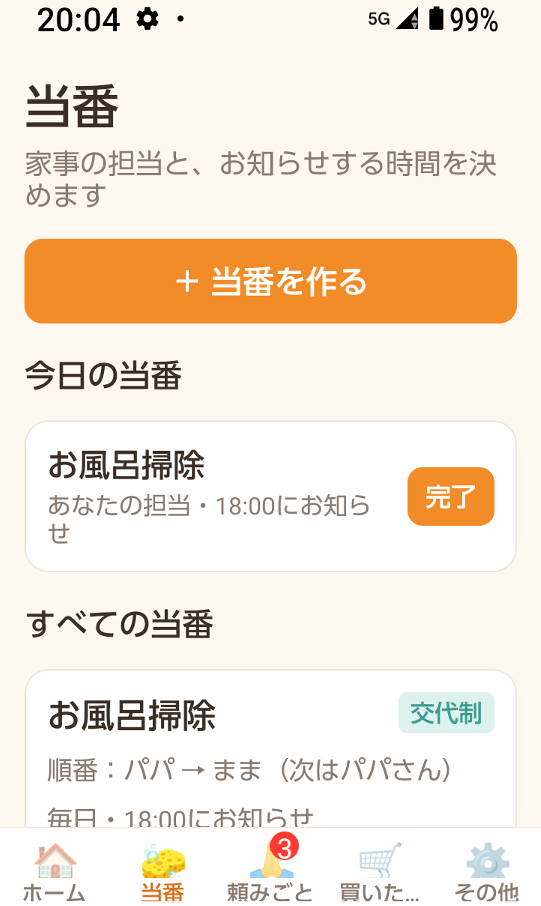
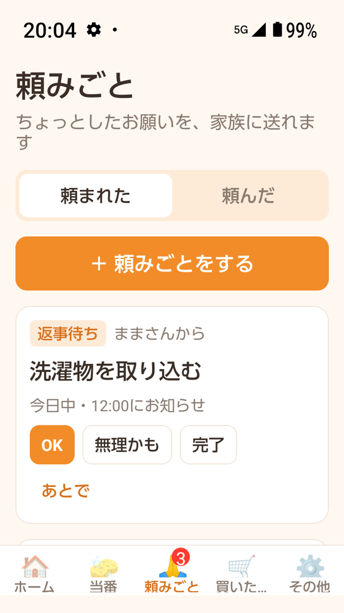
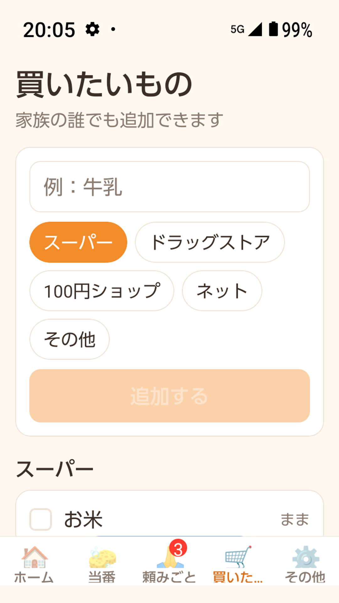
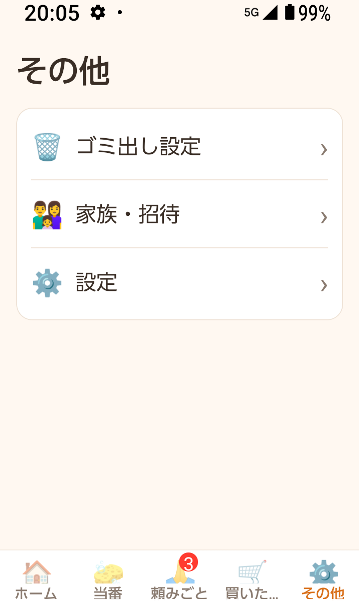

# カジまる — 家事を、家族でまるっと共有。

家事の分担と「やったよ」「ありがとう」を、家族で共有する Android アプリです。
企画・デザイン・開発・Google Play の審査対応まで、AI と一緒に一人で作りました。

🔗 [Google Play で見る](https://play.google.com/store/apps/details?id=com.smartlaboworks.kajimaru) ／ [紹介ページ](https://smartlaboworks.com/kajimaru/)

<p>
  
  
  
  
  
</p>

---

## できること

| 機能 | 内容 |
|---|---|
| 当番 | 家事ごとに担当と曜日を決めて、終わったらワンタップで「やったよ」 |
| ゴミ出し | 「毎週火曜」「第2・第4水曜」などの収集日を登録して、前日の決まった時間にお知らせ |
| 頼みごと | 家族に頼みごとを送り、返事や完了をすぐ通知 |
| 買いたいもの | 家族で共有する買い物リスト |
| 記録とありがとう | 誰が何をしたかの記録に「ありがとう」を送れる |
| 家族の招待 | 招待コード・QR コード・招待リンクで家族を追加（無料版は 2 人まで） |
| アカウント | Google ログインとメールアドレスでのログイン、アイコン写真、退会 |

---

## 使っている技術

| 分類 | 技術 |
|---|---|
| アプリ | Expo（React Native）、TypeScript、Expo Router |
| ログイン | Firebase Authentication（Google ログイン・メールアドレス） |
| データ | Cloud Firestore（家族のデータをリアルタイムで共有） |
| 写真 | Cloud Storage for Firebase（アイコン写真） |
| 通知 | Cloud Functions ＋ Expo の通知サービス |
| その他 | expo-camera（QR コード読み取り）、AdMob（広告）、EAS Build（アプリの組み立て） |

---

## 工夫したところ

**家族のデータを守るセキュリティルール**（[firestore.rules](firestore.rules)・[storage.rules](storage.rules)）
- 「同じ家族のメンバーだけが、その家族のデータを読み書きできる」をサーバー側のルールで守っています
- 家族への参加は「正しい招待コードを持っている人が、自分 1 人だけを追加する」場合だけ許可し、無料版の 2 人までという上限もルールで確認しています
- 招待コードは 1 件ずつしか調べられず、一覧を取ることはできません
- アイコン写真は画像だけ・2MB まで、見られるのは本人と同じ家族だけです

**サーバーでの通知**（[functions/src/index.ts](functions/src/index.ts)）
- 1 分ごとに「お知らせする時間」になった当番・ゴミ出し・頼みごとを探して通知します
- 頼みごとに返事や完了があったら、頼んだ人へすぐ通知します
- 通知の予約データはサーバーだけが扱い、アプリからは読み書きできません

**スマホとブラウザで同じコードを動かす**
- Google ログイン・広告・QR 読み取りなどスマホにしかない機能は、`*.native.tsx` / `*.native.ts` に分けています。開発中はブラウザでも画面を確認できます

**Google Play の審査対応**
- プライバシーポリシー、データセーフティ、広告 ID の申告、審査用アカウントの準備などを [docs/play-review-checklist.md](docs/play-review-checklist.md) にまとめて進めました
- リリース版だけ起動直後に落ちる問題を調べ、コードの縮小処理（R8）で通知に必要な部品（WorkManager）が削られていたことを突き止めました。縮小処理を止め、必要な部品を残す設定を加えて直しています（[app.json](app.json)）

---

## フォルダ構成

```
src/
├── app/            画面（Expo Router。ファイル 1 つが 1 画面）
│   └── (tabs)/     ホーム・当番・頼みごと・買いたいもの・その他のタブ
├── components/     ボタンやカードなどの部品
├── lib/            Firebase とのやりとり（家族・当番・ゴミ出し・通知など）
├── store/          アプリ全体の状態
└── types.ts        データの型
functions/          サーバー側の処理（Cloud Functions）
firestore.rules     データベースのセキュリティルール
storage.rules       写真のセキュリティルール
docs/               Google Play 審査のチェックリストなど
```

---

## 動かし方

```bash
npm install
cp .env.example .env.local   # Firebase などの値を入れる
npx expo start
```

Google ログイン・広告・通知はスマホ用の開発ビルドが必要です（`npx eas-cli build --profile development`）。

---

## AI との開発

- 仕様を先に文章で決め、AI（Claude Code）に実装を任せて、Android の実機で 1 つずつ確かめながら進めました
- AI 向けのルールを [AGENTS.md](AGENTS.md) に置いて、Expo のバージョンに合った書き方をそろえています

---

© 2026 株式会社スマートラボ. All rights reserved.（[LICENSE](LICENSE)）
